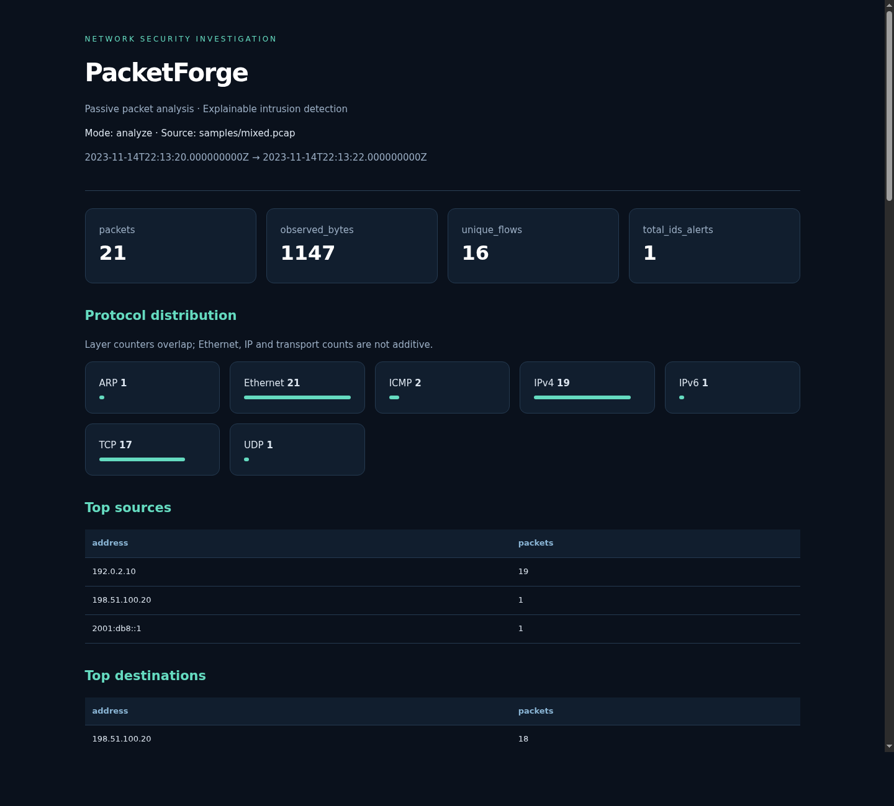

# PacketForge

**A passive C++ network packet analyzer and lightweight, explainable intrusion detection system.**

Author: **Mayank Kumar Karn** · C++17 · Linux / Kali / Ubuntu · CMake

PacketForge captures frames with Linux `AF_PACKET`, reads standard Ethernet PCAP
files with libpcap, decodes protocol metadata safely, tracks directional flows,
and reports suspicious activity using configurable rules. The complete offline
demonstration runs without root or internet access.

This project grew from the original PacketForge raw-socket sniffer and first-match
policy demonstration. The original Git history is preserved; the engineering review
is in [docs/AUDIT.md](docs/AUDIT.md). It is an educational investigation tool, not a
replacement for Wireshark, tcpdump, Snort or Suricata.

## Implemented features

- Bounded Ethernet II, up to two 802.1Q/802.1ad VLAN tags, Ethernet/IPv4 ARP,
  IPv4 including options, IPv6 with common extension headers, TCP, UDP, ICMP and
  basic ICMPv6 metadata decoding.
- Explicit `ok`, `truncated`, `malformed` and `unsupported` parser results.
  Non-initial IP fragments never supply transport ports. No network-buffer struct casts.
- Live interface selection, count/duration limits, Ctrl+C/SIGTERM shutdown,
  socket-scoped opt-in promiscuous mode, kernel capture timestamps and drop counters.
- Classic PCAP with microsecond/nanosecond timestamps and either byte order.
  PCAPNG, non-Ethernet link types and nonchronological captures are explicitly rejected.
- Bounded directional TCP/UDP five-tuples, packet/byte counts, timestamps, TCP flags,
  duration, idle expiry, capacity eviction and visible retention counters.
- Five configurable metadata rules: possible TCP SYN port scans, high SYN rate,
  high ICMP echo rate, sensitive service observations and connection concentration.
- Sliding windows, exact-IP exclusions, per-rule severity, thresholds, cooldowns,
  deduplication, rule counters and bounded detector state.
- Protocol counts, rates, top talkers/ports, unique and active flows, alert totals.
- Consistent alert evidence, timestamps, limitations, investigation recommendations
  and the justified T1046 reference for possible service discovery.
- JSON, alerts/flows CSV, and standalone HTML investigation reports. All generated
  reports contain metadata, never packet payloads. HTML is escaped; CSV neutralizes
  spreadsheet formulas; existing output files are not overwritten.
- **Firewall Policy Simulation** prints `WOULD_ALLOW` / `WOULD_BLOCK` using the
  original first-match concept. It does **not** drop, forward or modify traffic.

## Build on Kali / Ubuntu

```bash
sudo apt update
sudo apt install build-essential cmake libpcap-dev python3 libcap2-bin iproute2
cmake -S . -B build -DCMAKE_BUILD_TYPE=Release
cmake --build build -j2
ctest --test-dir build --output-on-failure
```

Python is only used by development tests and fixture generation. Runtime dependencies
are the C++ runtime and libpcap. The MIT-licensed nlohmann JSON header is vendored and
pinned, so CMake never downloads dependencies. To build without development tests,
add `-DBUILD_TESTING=OFF`.

## Five-minute offline demonstration

```bash
./build/packetforge --help
./build/packetforge analyze --pcap samples/demo.pcap
./build/packetforge analyze --pcap samples/portscan.pcap --ids
./build/packetforge analyze --pcap samples/synrate.pcap
./build/packetforge analyze --pcap samples/malformed.pcap --verbose
./build/packetforge analyze --pcap samples/sensitive.pcap --policy
./build/packetforge analyze --pcap samples/mixed.pcap \
  --rules config/rules.json --report all --output reports/interview
```

Open `reports/interview.html` in a local browser. The same prefix creates
`interview.json`, `interview-alerts.csv` and `interview-flows.csv`.
Choose a new prefix for a repeat run. Without `--output`, the filename contains a
unique export timestamp. `scripts/demo.sh` creates a new demonstration directory.

Actual default-fixture alert examples:

```text
[MEDIUM] POSSIBLE_TCP_PORT_SCAN | 2023-11-14T22:13:20.550000000Z | 192.0.2.10 -> 198.51.100.20 | observed=12 threshold=12 window=10s
[MEDIUM] HIGH_TCP_SYN_RATE | 2023-11-14T22:13:24.950000000Z | 192.0.2.10 -> 198.51.100.20 | observed=100 threshold=100 window=10s
```

The normal mixed fixture contains 9 packets and raises no default alerts. The SYN
rate fixture intentionally repeats an attempt to distinguish packet rate from
unique connection attempts. These are deterministic synthetic captures using
reserved documentation addresses, with no third-party traffic or credentials.
See [samples/README.md](samples/README.md) for every expected outcome.

## Report preview



The preview is rendered from the synthetic mixed-protocol report. No external
fonts, scripts, images, services or internet connection are needed by the HTML.

## Live capture

Only inspect an interface or capture file you are authorized to monitor.

```bash
./build/packetforge interfaces
sudo ./build/packetforge capture --interface eth0 --count 100
sudo ./build/packetforge capture --interface eth0 --duration 30 --report html
```

An alternative to running the application as root on a Linux filesystem is:

```bash
sudo setcap cap_net_raw=ep ./build/packetforge
./build/packetforge capture --interface eth0 --count 100
# Remove the capability when it is no longer needed:
sudo setcap -r ./build/packetforge
```

Do not grant capabilities to a binary that untrusted users can replace. Prefer a
Linux home-directory checkout when using file capabilities; Windows-mounted WSL
filesystems may not support them. Rebuilding/replacing a binary can remove its
capabilities. Native Linux or a Linux VM is recommended for predictable NIC
visibility. WSL2 can capture interfaces in its Linux environment, but this does not
mean it sees every Windows interface or all LAN traffic. Wi-Fi monitor mode is not
implemented. Loopback may expose both outgoing and incoming copies.

No promiscuous mode is requested unless `--promiscuous` is supplied. Capture is
passive: there is no packet injection, retransmission, firewall modification,
NFQUEUE, credential interception, persistence or stealth functionality.

## CLI reference

| Command / flag | Behavior |
| --- | --- |
| `interfaces` | Enumerate Linux interface indices and names |
| `capture --interface NAME` | Start passive AF_PACKET capture |
| `analyze --pcap FILE` | Read chronological classic Ethernet PCAP |
| `--count N` | Stop after N packets; positive integer |
| `--duration SECONDS` | Live-only elapsed-time limit; fractions allowed, maximum 86400 |
| `--ids`, `--no-ids` | IDS is enabled by default; explicitly enable or disable |
| `--rules FILE` | Load validated JSON overrides; built-in defaults otherwise |
| `--policy` | Print Firewall Policy Simulation decisions |
| `--verbose` | Print metadata for each packet; no payloads |
| `--quiet` | Suppress immediate alerts and periodic status; keep summary/reports |
| `--report json\|csv\|html\|all` | Export investigation artifacts |
| `--output PREFIX` | Output path prefix, requires `--report`; refuse existing files |
| `--promiscuous` | Live-only socket membership, released when socket closes |
| `--help` | Full command help |

Exit code 0 means successful analysis or graceful live stop, including suspicious
traffic. Exit code 2 means invalid arguments/configuration or a capture/report error.
Malformed individual packets are counted and analysis continues. Corrupt PCAP
containers cause an error. The application does not silently sort huge captures:
nonchronological files must be sorted externally before use.

The historical `sniffer` and `forwarder` CMake targets remain as compatibility
entry points: `./build/sniffer --interface eth0` and
`./build/forwarder --interface eth0`. The latter enables **simulation**. The old
single-file `g++ src/sniffer.cpp` command is superseded by CMake.

## Rules and limitations

[config/rules.json](config/rules.json) contains demonstration defaults, not universal
attack thresholds. Alerts trigger at **count >= threshold** within `(now-window, now]`.
A port-scan threshold cannot be set below two distinct ports. A sensitive service
observation is informational, and a SYN-rate alert does not confirm denial of service.
Tune using an authorized traffic baseline; see [DETECTION_RULES.md](docs/DETECTION_RULES.md).

There is no TCP stream reconstruction, IP fragment reassembly, DNS query parser,
DNS tunneling detector, payload inspection, decryption, checksum validation or
production throughput claim. DNS traffic is represented as UDP metadata only.
Bounded tables can omit evidence; reports expose dropped rule events/keys,
flow evictions, omitted talker observations and unretained alerts. Unique flow
counts become a labeled lower bound when their identity budget is exhausted.

Protocol counters overlap layers. Byte counts mean captured/observed frame bytes;
wire lengths are tracked separately. Rates cover the first-to-last packet interval
and are undefined for zero-duration observations. Frame check sequences, NIC
segmentation/coalescing offloads, capture loss and capture position affect results.

Reports contain IP addresses, MAC-derived packet metadata and service relationships;
handle them as investigation data. Reports are created with POSIX mode 0600 where
the filesystem supports it. No real packet captures are committed to this repository.

## Engineering documentation

- [Architecture and resource bounds](docs/ARCHITECTURE.md)
- [Protocol decoding and validation](docs/PROTOCOLS.md)
- [Detection algorithms and tuning](docs/DETECTION_RULES.md)
- [Tests, sanitizers and live verification](docs/TESTING.md)
- [Interview explanations and demo](docs/INTERVIEW_PREP.md)
- [Initial audit and corrections](docs/AUDIT.md)
- [Implementation status](PROGRESS.md)
