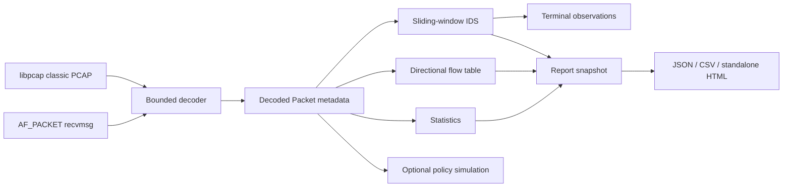

# PacketForge architecture

## Shared pipeline

Both capture sources invoke the same `PacketConsumer`. No detection implementation
is duplicated between live and offline modes. Offline processing uses recorded
capture timestamps, so replay speed does not affect rules.

## Components

| Component | Files | Responsibility |
| --- | --- | --- |
| Entry points | `src/main.cpp`, `src/sniffer.cpp`, `src/forwarder.cpp` | Main CLI and legacy wrappers |
| CLI | `src/cli.cpp` | Validate arguments, choose mode, print metadata, orchestrate exports |
| Capture | `src/capture/live.cpp`, `pcap.cpp` | Socket/pcap ownership, limits, callbacks |
| Parser | `src/parsers/packet.cpp`, `include/packetforge/packet.hpp` | Bounded byte decoding and host-order metadata |
| Rules | `src/detection/config.cpp`, `config/rules.json` | Strict validated JSON and safe defaults |
| IDS | `src/detection/detection.cpp` | Metadata windows, evidence, cooldowns and counters |
| Flows | `src/flows/flows.cpp` | Directional five-tuples and retention |
| Statistics | `src/statistics/` | Counters, top addresses/ports, shared analysis snapshot |
| Policy | `include/rules.hpp` | Original first-match concept with simulation labels |
| Reporting | `src/reporting/reporting.cpp` | JSON serialization, CSV/HTML escaping, exclusive file creation |

## Capture ownership and shutdown

Live capture owns a close-on-exec AF_PACKET socket through a noncopyable RAII wrapper.
It binds to an explicit Linux interface. Only Ethernet and Linux loopback hardware
types are accepted. `recvmsg(MSG_TRUNC)` distinguishes received wire length from the
buffer capacity. `PACKET_AUXDATA` restores a VLAN tag stripped by hardware when
provided by the kernel. `SO_TIMESTAMPNS` supplies kernel receive timestamps.
Promiscuous membership is scoped to the socket and released by close.

A minimal signal handler only sets `volatile sig_atomic_t`; polling checks it.
SIGINT and SIGTERM restore previous handlers on exit. `poll` wakes at most every
100 ms to enforce duration limits, even on idle interfaces. Capture timestamps
are clamped to the last live timestamp if wall-clock time moves backwards;
duration uses `steady_clock`. Packet processing/export time can add shutdown
latency. Kernel drop counts are read using `PACKET_STATISTICS`.

The PCAP reader owns `pcap_t` with `unique_ptr` and `pcap_close`. It requests
nanosecond timestamp precision, checks the classic-file magic and Ethernet link
kind, validates capture/wire metadata, and streams one frame at a time. It rejects
decreasing timestamps instead of silently adjusting evidence or loading an
unbounded file for sorting. Equal timestamps are valid. Container corruption
aborts the run; malformed packet contents are ordinary parser results.

## Packet ownership and safety

The parser borrows a buffer only during `parse_packet`; the returned `Packet`
contains copied strings and scalar values, never pointers into capture memory.
The decoder checks offset and remaining length before every field read. Reads are
explicit big-endian byte assembly. After parsing IP lengths, the decoder's limit
is reduced to that IP packet, so Ethernet padding cannot supply missing headers.
Parsing exceptions are internal fixed-size status markers caught at the boundary;
resource failures such as allocation errors propagate to the CLI.

No packet payload is stored in analysis state. No packet structs are cast over
untrusted input. Socket API structures are ordinary kernel ABI structures, not
packet overlays. Alignment and compiler struct padding therefore cannot affect
network parsing.

## Flows and storage bounds

A key is `(source IP, destination IP, source port, destination port, protocol)`.
Traffic in the reverse direction is a separate row. Packet count, observed/wire
bytes, first/last times and bitwise TCP flag observations are tracked. A row is
neither a TCP connection state machine nor a reconstructed stream. Fragmented
packets are excluded, including initial fragments, to avoid partial flow evidence.
ICMP and ARP contribute to statistics but do not create transport five-tuples.

Default bounds:

| State | Bound | Behavior at capacity |
| --- | ---: | --- |
| Active flows | 4096 | Archive least recently observed row; increment eviction counter |
| Archived flows | 4096 | Discard oldest archived row; count discards |
| Unique five-tuples | 65536 | Stop retaining new identities; label total a lower bound |
| Source and destination counters | 4096 each | Retain existing identities; count omitted observations |
| Destination-port counters | 65536 possible ports | Naturally bounded numeric key space |
| Rule keys | 1024 per rule | Skip new keys; count omissions |
| Rule events | 50000 per rule | Skip new evidence; count omissions |
| Retained alert objects | 10000 | Keep total counters and emitted alerts, discard additional stored objects |

Flows expire after 60 seconds of inactivity by default. Maintenance is checked
once per timestamp second, with forced final expiry after live capture. Offline
active means active at the last observed timestamp, not active in the present day.
IDS keys remain until both their observation window and cooldown are no longer
needed. Reports expose capacity loss; bounded storage implies possible false negatives.
Top talkers are exact only within retained identities, and may omit a later busy
source if the identity budget is already full.

## Detection execution and performance

Each enabled rule has its own keyed deque of timestamped events. At an observation,
old events outside `(now-window, now]` are removed before counting. Distinct port
or attempt sets are built from retained events. Retransmissions count for SYN rate,
but identical `(destination, source port, destination port, sequence)` attempts
are deduplicated for concentration. Evidence samples are capped at 32 ports.

The implementation is single-threaded for deterministic reasoning and tests.
Parsing is proportional to a bounded header chain; flow lookup uses ordered maps.
Distinct evidence counting is linear/log-linear in a key's retained window, and
capacity eviction scans the bounded active-flow table. This is appropriate for a
small educational sensor, not an optimized line-rate engine. Future work should
profile first, then consider incremental counters, indexed expiry, PACKET_MMAP,
flow-affine workers and streaming report sinks. No throughput numbers are claimed.

## Report trust boundaries

JSON uses a maintained serializer. HTML escapes every dynamic string and includes
a restrictive Content Security Policy; it contains no scripts or remote assets.
CSV quotes all fields, doubles embedded quotes and prefixes formula-triggering
values with an apostrophe. Files are created exclusively with `O_EXCL` and mode
0600; existing files and symlinks are not overwritten. A multi-file export is not
transactional: a later I/O failure may leave earlier files or a partial failed file,
which is reported as an error. No autosending or external upload is performed.
